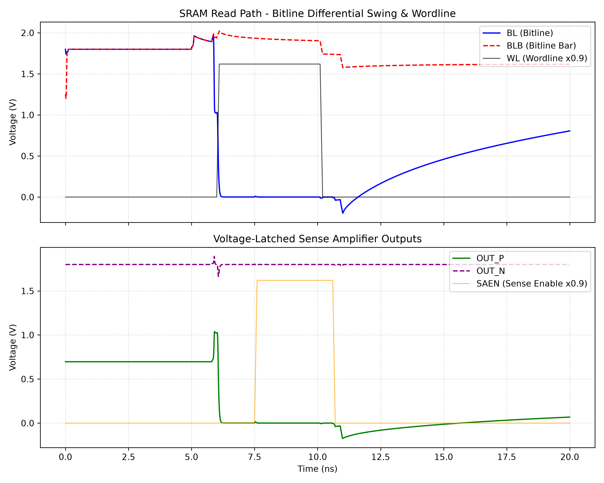

# 6T SRAM Read Path & Voltage-Latched Sense Amplifier (VLSA)

A SPICE-based simulation framework for the read path of a 6T SRAM: bitcell, bitline pre-charge/equalization, and a voltage-latched sense amplifier. The current runnable flow uses Ngspice and the ASU Predictive Technology Model (PTM) 130 nm (BSIM4, `level=54`), with Python scripts for waveform parsing and plotting.



---

## Highlights

- Physics-based BSIM4 transistor models (PTM 130 nm)
- Complete read sequence: pre-charge, equalize, wordline assertion, bitline differential development, sense-enable, and latch resolution
- Scripted simulation, raw-data parsing, and waveform plotting
- Plain-text netlists that are easy to modify and extend

## Project Structure

```text
sramsa/
├── models/
│   └── ptm/
│       └── ptm130.pm          # ASU PTM 130 nm BSIM4 transistor models
├── netlists/
│   ├── sram_cell.spice        # 6T cell, pre-charge, and sense-amplifier subcircuits
│   └── sram_tb.spice          # Top-level testbench, stimuli, and control blocks
├── results/
│   ├── sram_tran.raw          # Ngspice raw transient data (generated)
│   └── sram_waveforms.png     # Plotted waveforms (generated)
├── plot_sram.py               # Raw-file parser and waveform plotter
└── README.md                  # Project documentation
```

## Circuit Overview

| Block | Subcircuit | Description |
|-------|-----------|-------------|
| 6T bitcell | `sram_6t` | Two cross-coupled CMOS inverters and two NMOS access transistors gated by `WL`, connected to complementary bitlines `BL` and `BLB`. |
| Pre-charge & equalizer | `sram_precharge` | Pre-charges both bitlines to 1.8 V and equalizes them before access. |
| Voltage-latched sense amp | `voltage_sense_amp` | On `SAEN`, amplifies the bitline differential into complementary rail-to-rail outputs `OUT_P` and `OUT_N`. |

### Read Operation

1. Pre-charge `BL` and `BLB` to 1.8 V and equalize them.
2. Assert `WL`; the cell discharges one bitline and develops a differential voltage.
3. Assert `SAEN` after sufficient differential develops.
4. The latch resolves to complementary full-swing outputs.

## Prerequisites

| Tool | Purpose |
|------|---------|
| [Ngspice](https://ngspice.sourceforge.io/) | Circuit simulation; must be on `PATH` |
| Python 3.8+ | Waveform parsing and plotting |
| `numpy`, `matplotlib` | Python plotting dependencies |

Install the Python dependencies:

```powershell
pip install numpy matplotlib
```

## Running the Simulation

Run the transient simulation:

```powershell
cd netlists
ngspice sram_tb.spice
```

The testbench writes raw data to `results/sram_tran.raw`. Generate the waveform plot with:

```powershell
python plot_sram.py
```

The script displays `BL`, `BLB`, `WL`, `SAEN`, `OUT_P`, and `OUT_N`, and saves a high-resolution plot to `results/sram_waveforms.png`.

## Customizing the Simulation

- Edit the supply and `WL`/`SAEN`/pre-charge pulse definitions in `netlists/sram_tb.spice` to change supply or timing.
- Adjust transistor W/L in `netlists/sram_cell.spice` to change cell ratio or sense-amplifier sizing.
- To use another process model, update the model file and `.include` path in the testbench.

## Roadmap

- Characterize sensing margin versus `SAEN` timing and bitline differential.
- Analyze temperature and supply corners and Monte Carlo sense-amplifier mismatch.
- Explore SkyWater Sky130 models and device sizing as an alternative process-model flow.
- Compare against a current-latched sense amplifier and investigate layout with parasitic extraction.

